# Manual de usuario · Ferretería Los Maestros

Este manual explica cómo poner en marcha la tienda y cómo la usa cada tipo de usuario: **visitante**, **cliente**, **vendedor** y **administrador**. Cada paso lleva una captura de la aplicación funcionando contra el backend real.

> Para la arquitectura, los endpoints y las pruebas de la API, ver el **documento de integración** en el repositorio del backend (`docs/documento-integracion.md`).

## Índice

1. [¿Qué es Ferretería Los Maestros?](#1-qué-es-ferretería-los-maestros)
2. [Instalación y arranque](#2-instalación-y-arranque)
3. [Visitante: recorrer la tienda](#3-visitante-recorrer-la-tienda)
4. [Cliente: iniciar sesión y comprar](#4-cliente-iniciar-sesión-y-comprar)
5. [Vendedor: gestionar pedidos](#5-vendedor-gestionar-pedidos)
6. [Administrador: panel, productos y usuarios](#6-administrador-panel-productos-y-usuarios)
7. [Sesión: recarga, expiración y cierre](#7-sesión-recarga-expiración-y-cierre)
8. [Mensajes frecuentes y cómo resolverlos](#8-mensajes-frecuentes-y-cómo-resolverlos)

---

## 1. ¿Qué es Ferretería Los Maestros?

Es una tienda web de artículos de ferretería. Cualquier persona puede ver el catálogo y armar un carrito. Para comprar hay que iniciar sesión como cliente. El personal de la tienda entra a su propio panel según su rol.

| Rol | Qué puede hacer | Página de inicio después del login |
| --- | --- | --- |
| **Visitante** (sin sesión) | Ver el inicio, el catálogo y el detalle de los productos, buscar, filtrar y armar el carrito | — |
| **Cliente** | Todo lo del visitante, además de **confirmar la compra** | Inicio (`/`) |
| **Vendedor** | Ver todos los pedidos, revisar su detalle y cambiar su estado | Panel del vendedor (`/vendedor`) |
| **Administrador** | Ver los indicadores de la tienda y administrar productos y usuarios | Panel de administración (`/admin`) |

Cada panel está protegido. Si alguien sin sesión o con otro rol escribe la dirección de un panel, la aplicación no lo deja entrar. Además, el backend vuelve a comprobar el rol en cada petición.

---

## 2. Instalación y arranque

### 2.1 Requisitos

- **JDK 21** (backend Spring Boot)
- **Node.js** 20.19 o superior, o 22.12 o superior (frontend React con Vite)
- **Docker Desktop**, para la base de datos MySQL
- Conexión a internet la primera vez, para descargar las dependencias

### 2.2 Pasos

Se necesitan **dos terminales**: una para el backend y otra para el frontend.

```bash
# Terminal 1 · Base de datos y backend
cd backend
cp .env.example .env          # luego reemplazar JWT_SECRET por una clave propia
                              # (se puede generar con: openssl rand -base64 48)
docker compose up -d          # levanta MySQL 8.4 en el puerto 3306
./mvnw spring-boot:run        # Windows: mvnw.cmd spring-boot:run
```

La primera vez, el backend crea las tablas y carga los datos de ejemplo. En la consola aparece el mensaje `Datos iniciales: 42 usuarios`. En los arranques siguientes ese mensaje no aparece, porque los datos ya existen.

```bash
# Terminal 2 · Frontend
cd frontend
npm install                   # solo la primera vez
npm run dev
```

Con todo arriba, abrir **<http://localhost:5173>** en el navegador.

| Servicio | Dirección |
| --- | --- |
| Tienda (frontend) | <http://localhost:5173> |
| API REST (backend) | <http://localhost:8080/api> |
| Documentación de la API (Swagger) | <http://localhost:8080/swagger-ui.html> |

### 2.3 Cuentas de demostración

| Rol | Correo | Contraseña |
| --- | --- | --- |
| Administrador | `admin@losmaestros.cl` | `admin123` |
| Vendedor | `vendedor@losmaestros.cl` | `vendedor123` |
| Cliente | `cliente@losmaestros.cl` | `cliente123` |

Las tres cuentas aparecen también en la pantalla de login, en el recuadro **"Cuentas de prueba para evaluación"**. Son solo para el entorno local y no corresponden a secretos reales.

### 2.4 Apagar el sistema

- Frontend y backend: `Ctrl + C` en cada terminal.
- Base de datos: `docker compose stop` en la carpeta `backend`. Los datos se conservan.
- Para volver a los datos iniciales: `docker compose down -v`. **Ojo:** borra todos los pedidos, productos y usuarios creados.

---

## 3. Visitante: recorrer la tienda

No hace falta iniciar sesión para nada de esta sección.

### 3.1 Página de inicio

La página de inicio presenta la tienda y sus categorías destacadas. La barra superior tiene:

- **Menú:** Inicio, Productos, Nosotros y Contacto.
- **Buscador** ("Buscar productos..."): lleva al catálogo con los resultados.
- **Carrito:** el ícono muestra cuántos productos hay.
- **Iniciar sesión.**

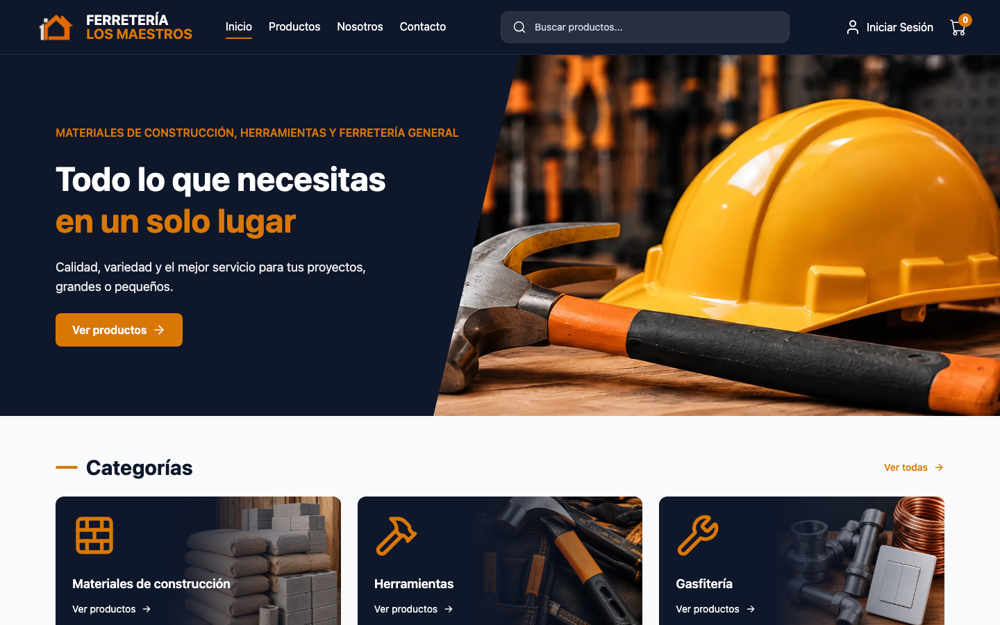

### 3.2 Catálogo de productos

En **Productos** se ve el catálogo completo, que llega desde el backend. Cada tarjeta muestra la imagen, el nombre, el precio y un botón para agregar el producto al carrito.

- **Ordenar por:** nombre (A-Z), precio de menor a mayor o precio de mayor a menor.
- La lista se divide en páginas, con botones al final para avanzar.

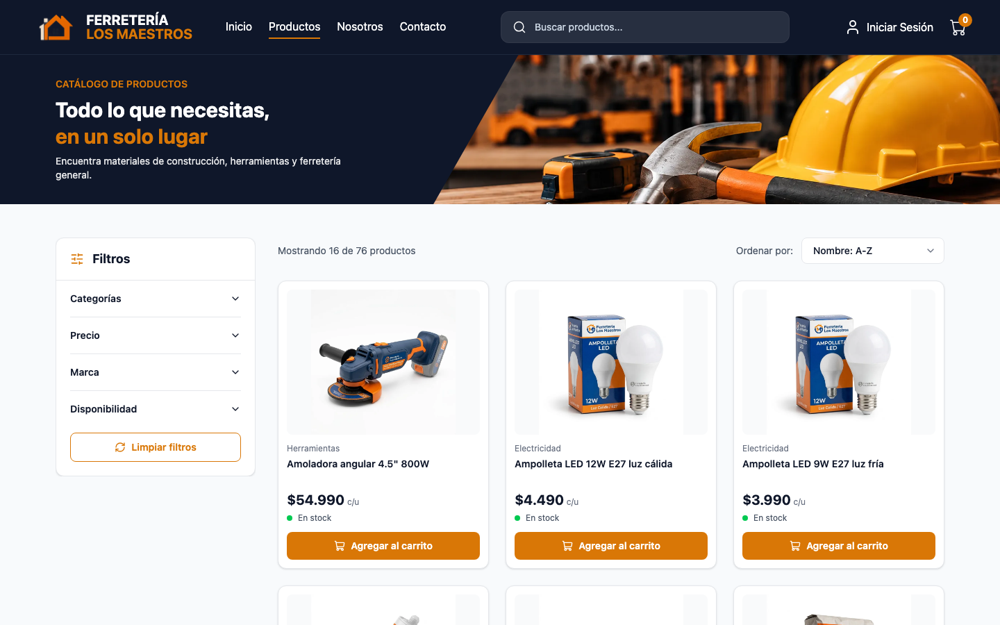

### 3.3 Filtrar y buscar

En el panel **Filtros** cada grupo se abre con un clic: **Categorías**, **Precio** (mínimo y máximo), **Marca** y **Disponibilidad**. El catálogo se actualiza al instante y muestra cuántos productos cumplen el filtro ("Mostrando 11 de 11 productos"). Los filtros se combinan con el texto del buscador, y **Limpiar filtros** los quita todos.

En la captura se marcó la categoría **Herramientas**:

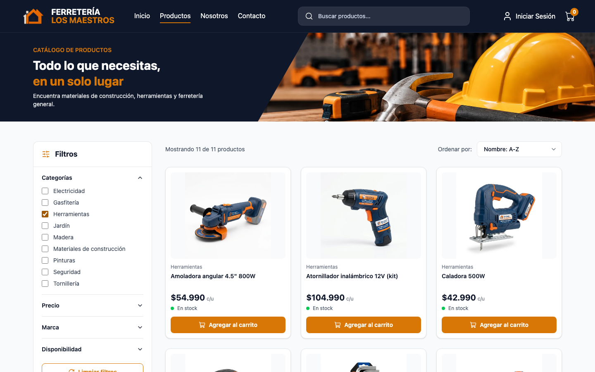

### 3.4 Detalle de un producto

Al hacer clic en un producto se abre su ficha, con el código, la marca, el precio, el stock disponible y una tabla de **Detalles del producto** (categoría, subcategoría, unidad de venta y disponibilidad).

1. Elegir la **cantidad** con los botones **−** y **+**. No se puede bajar de 1 ni pasar del stock.
2. Pulsar **Agregar al carrito** (aparece un aviso de confirmación) o **Comprar ahora**, que agrega el producto y lleva directo al carrito.

Si el producto no tiene stock, los botones quedan desactivados.

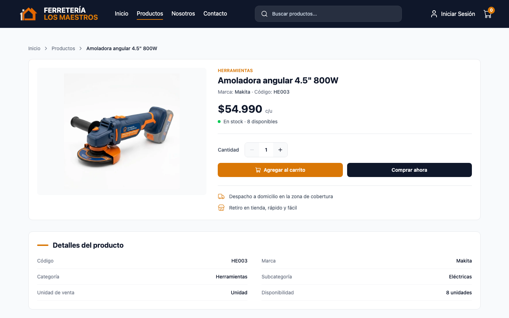

### 3.5 Carrito

En el carrito (ícono de la barra superior) se puede:

- Cambiar la cantidad de cada producto con **−** y **+**. El **+** se desactiva al llegar al stock disponible.
- Quitar un producto con el ícono de eliminar.
- **Vaciar el carrito**, después de confirmar el aviso.
- Ver el **Resumen del pedido** con el total.

El carrito queda guardado en el navegador: si se cierra la pestaña y se vuelve a abrir, los productos siguen ahí.

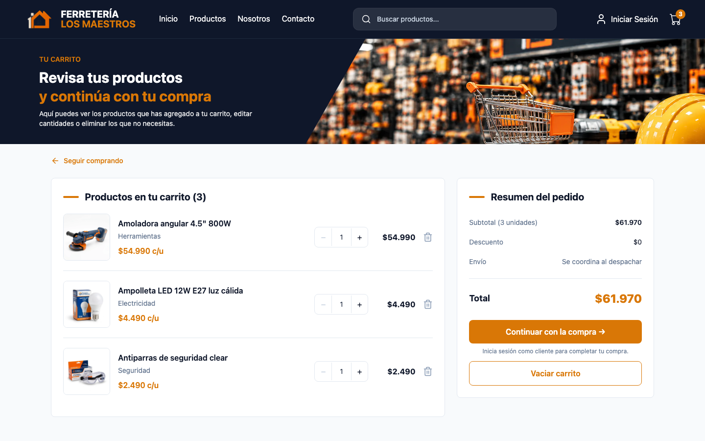

### 3.6 Para comprar hay que iniciar sesión

Si un visitante pulsa **Continuar con la compra**, la aplicación lo lleva a la pantalla de login. Después de iniciar sesión vuelve automáticamente al carrito, con sus productos intactos.

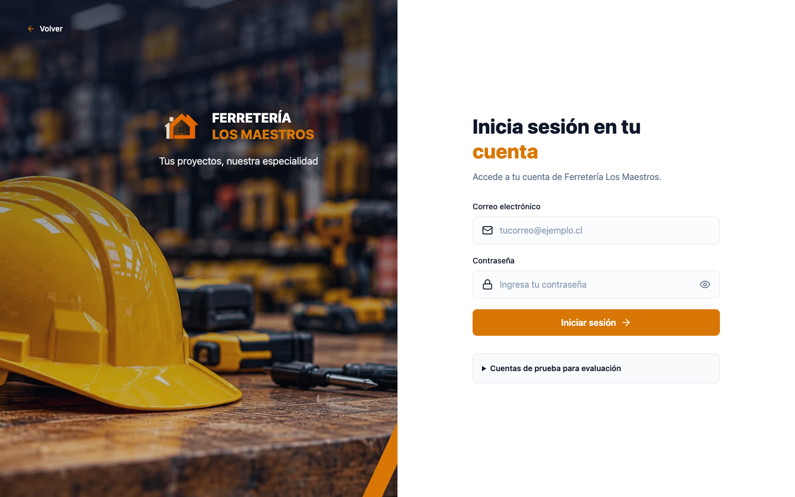

---

## 4. Cliente: iniciar sesión y comprar

### 4.1 Iniciar sesión

1. Ir a **Iniciar sesión** (o llegar desde el carrito, como en el punto 3.6).
2. Escribir el **correo** y la **contraseña**. El ícono del ojo muestra u oculta la contraseña.
3. Pulsar **Iniciar sesión**.

Si los datos no son correctos, aparece el mensaje **"Correo o contraseña incorrectos"**. Por seguridad, no indica cuál de los dos falló. Si la cuenta está *Inactiva*, el mensaje es "Tu cuenta está inactiva. Contacta al administrador".

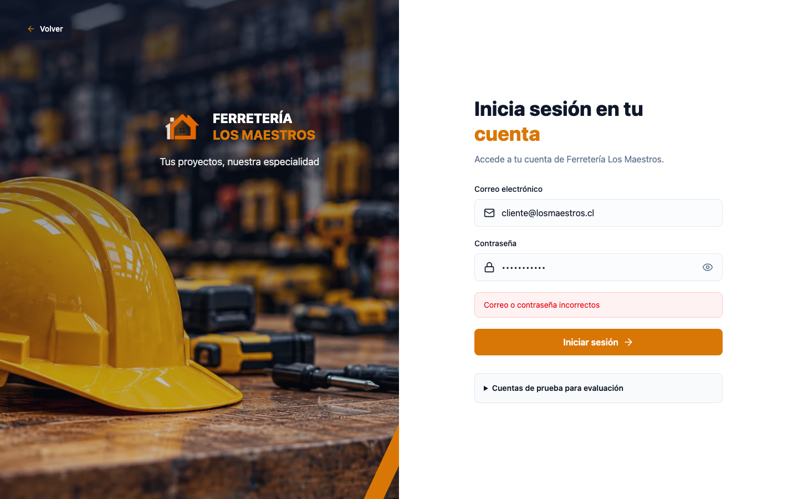

Con la cuenta de cliente (`cliente@losmaestros.cl` / `cliente123`):


### 4.2 Confirmar la compra

1. Ya con la sesión iniciada, abrir el **carrito** y revisar el **Resumen del pedido**.
2. Pulsar **Continuar con la compra →**. Mientras se procesa, el botón dice "Procesando pedido...".


3. El backend revisa que haya stock suficiente, lo descuenta y calcula el total con los precios vigentes. Si todo está bien, aparece **"¡Pedido #N creado!"** y el carrito se vacía.

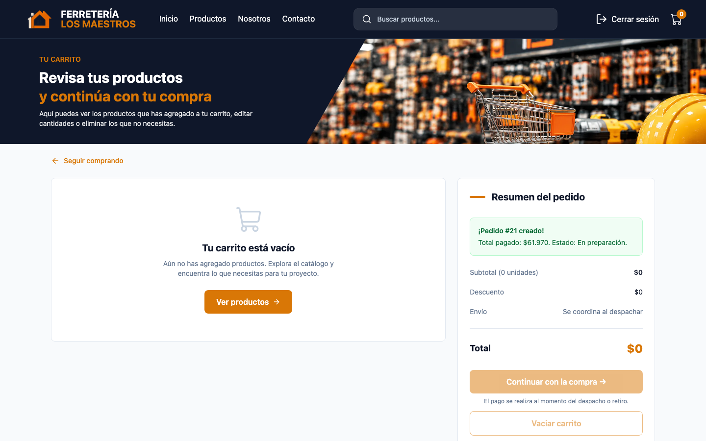

Si mientras tanto otro cliente compró el último stock de un producto, el pedido no se crea y aparece un mensaje que dice qué producto no tiene stock suficiente. El catálogo se actualiza solo para mostrar el stock real.

El pedido creado aparece de inmediato en el panel del vendedor con el estado **En preparación**.

---

## 5. Vendedor: gestionar pedidos

Iniciar sesión con `vendedor@losmaestros.cl` / `vendedor123`. La aplicación abre directamente el **panel del vendedor**.

### 5.1 Lista de pedidos

La tabla muestra todos los pedidos de la tienda, del más nuevo al más antiguo, con su número, cliente, fecha, total y estado. Los estados tienen colores distintos para reconocerlos rápido. En la captura, el pedido **#21** es el que creó el cliente en el punto 4.2.

El menú lateral muestra otras secciones (Dashboard, Productos, Clientes, Reportes y Configuración) en gris: están desactivadas porque no forman parte de esta versión. La sección activa es **Pedidos**.

- **Buscador:** por número de pedido, cliente o producto.
- **Filtros:** por **Estado** (Todos, En preparación, Enviado o Entregado) y por **Fecha** (Todas, últimos 7 días o últimos 30 días).

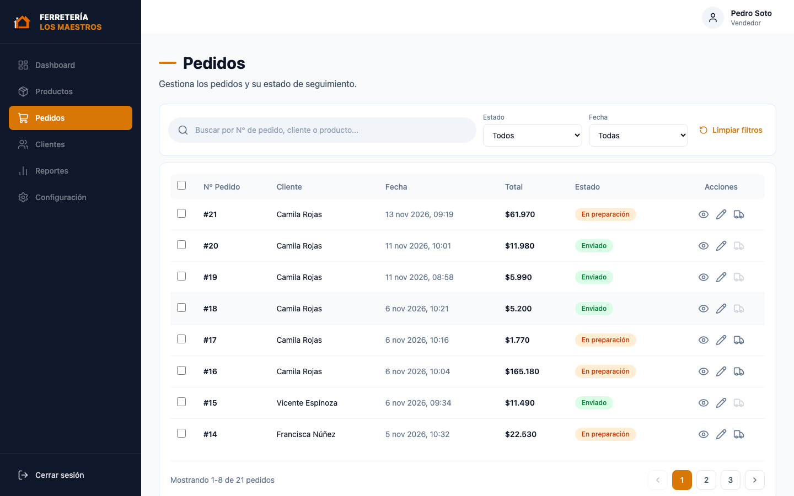

### 5.2 Ver el detalle de un pedido

El botón **Ver** (ícono de ojo) abre el **Detalle del pedido**: los datos del cliente, los productos con su cantidad y precio, y el total.

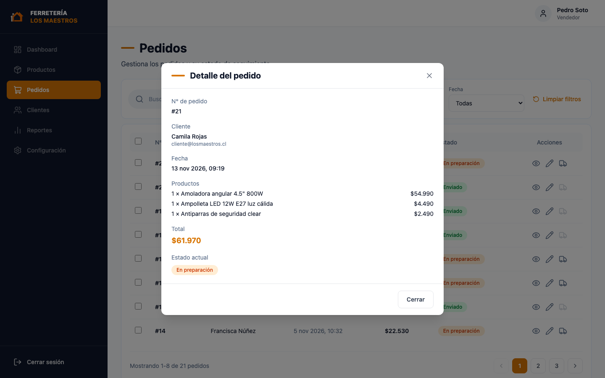

### 5.3 Cambiar el estado de un pedido

Un pedido pasa por tres estados:

```
En preparación  →  Enviado  →  Entregado
```

Un pedido no puede retroceder ni saltarse un estado. Por eso la aplicación no deja elegir cualquier estado: siempre ofrece solo **el siguiente paso**.

- **Editar estado** (ícono de lápiz): abre la ventana **Cambiar estado** con el detalle del pedido, su estado actual y el siguiente paso. El botón **Cambiar a "…"** aplica el cambio. Se desactiva cuando el pedido ya está *Entregado*.
- **Enviar** (ícono de camión): atajo que marca el pedido como *Enviado* en un clic. Solo está disponible si el pedido está *En preparación*.

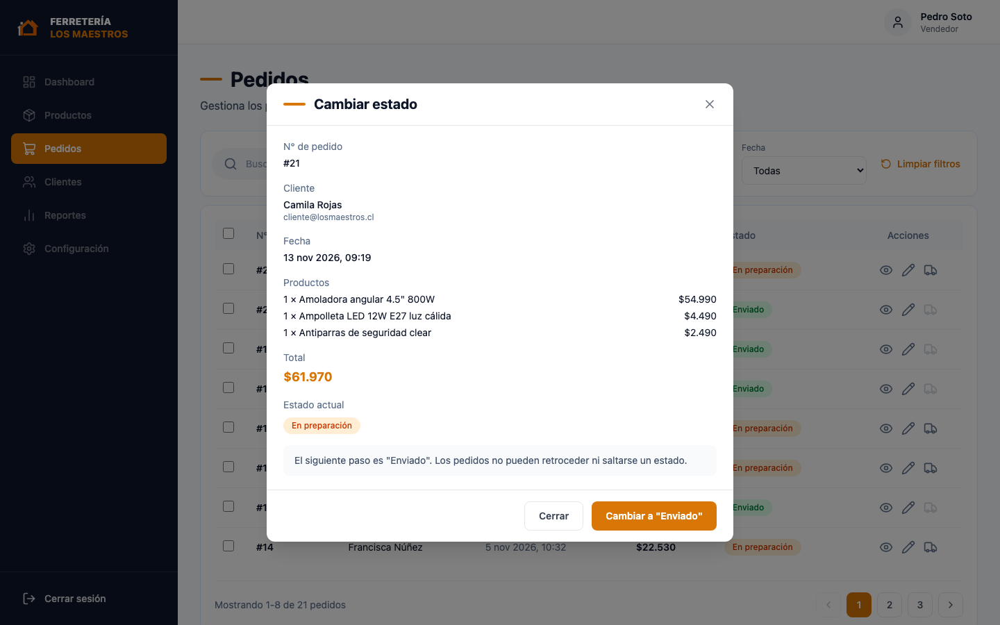

Al pulsar **Cambiar a "Enviado"** aparece el aviso *"El pedido #21 quedó "Enviado""* y la tabla se actualiza. Como el pedido ya no está *En preparación*, el botón **Enviar** queda desactivado:

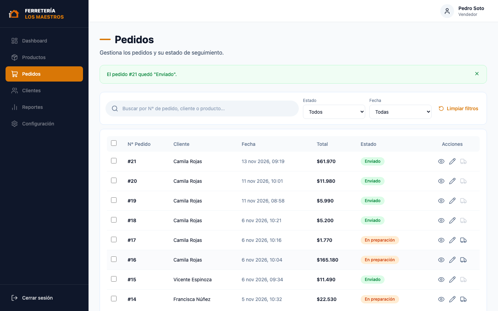

---

## 6. Administrador: panel, productos y usuarios

Iniciar sesión con `admin@losmaestros.cl` / `admin123`. La aplicación abre el **Panel de administración**. El menú lateral lleva a **Dashboard**, **Productos** y **Usuarios**.

### 6.1 Dashboard

Muestra un resumen de la tienda, calculado por el backend:

- **Productos**, con cuántos tienen stock bajo o están sin stock.
- **Pedidos del mes** y su variación respecto del mes anterior.
- **Usuarios registrados.**
- **Ventas del mes** y su variación.
- **Pedidos recientes.**

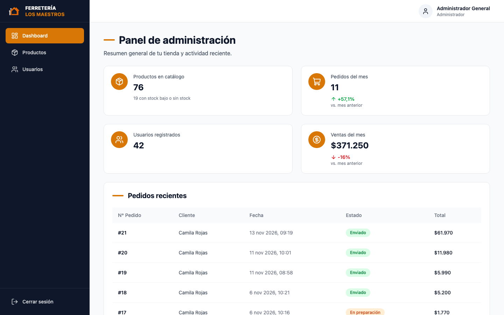

### 6.2 Lista de productos

La tabla muestra el código, el nombre, la categoría, el precio, el stock y el **estado de stock** (*En stock*, *Bajo stock* o *Sin stock*, según el stock mínimo de cada producto).

- **Buscador:** por nombre o categoría.
- **Filtros:** por categoría y por estado de stock.

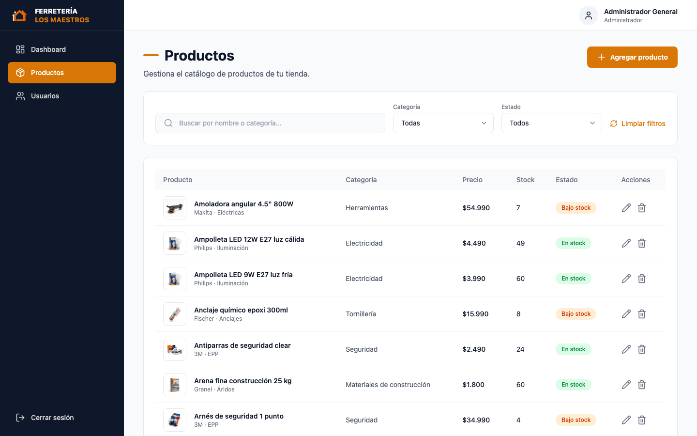

### 6.3 Agregar un producto

1. Pulsar **Agregar producto**.
2. Completar el formulario. Los campos con * son obligatorios. En la captura se agrega el producto **MN102 · Rotomartillo SDS Plus 800W**.

| Campo | Regla |
| --- | --- |
| Código | 2 letras mayúsculas y 3 números (ej. `MC001`). No se puede repetir |
| Nombre del producto | Entre 3 y 80 caracteres |
| Categoría / Subcategoría / Marca | Obligatorias |
| Unidad de venta | Se elige de la lista (por ejemplo, Unidad o Saco) |
| Precio de compra / Precio de venta | Números enteros mayores a 0. El de venta no puede ser menor que el de compra |
| Stock inicial / Stock mínimo | Números enteros |
| Descripción e Imagen | La imagen es una ruta que empieza con `/` o una URL `https://...` |

3. Pulsar **Agregar producto** (al editar, **Guardar cambios**). Si hay errores, cada campo muestra su mensaje en rojo y el cursor salta al primero. El backend también valida los datos: por ejemplo, si el código ya existe, lo indica en el campo **Código**.

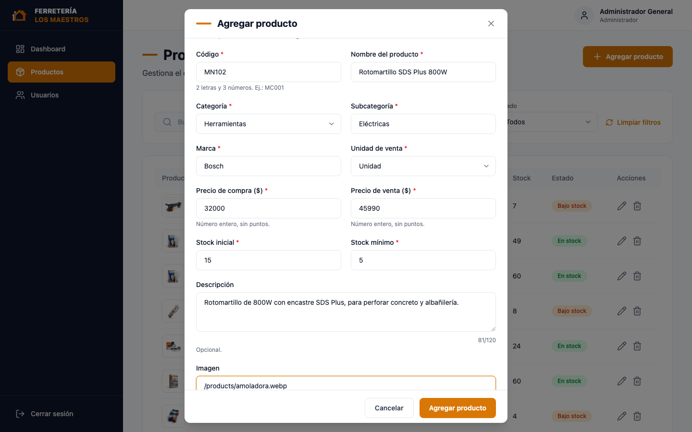

Al guardar, la ventana se cierra y aparece un aviso de confirmación. El producto ya se ve en la tabla y en el catálogo de la tienda.

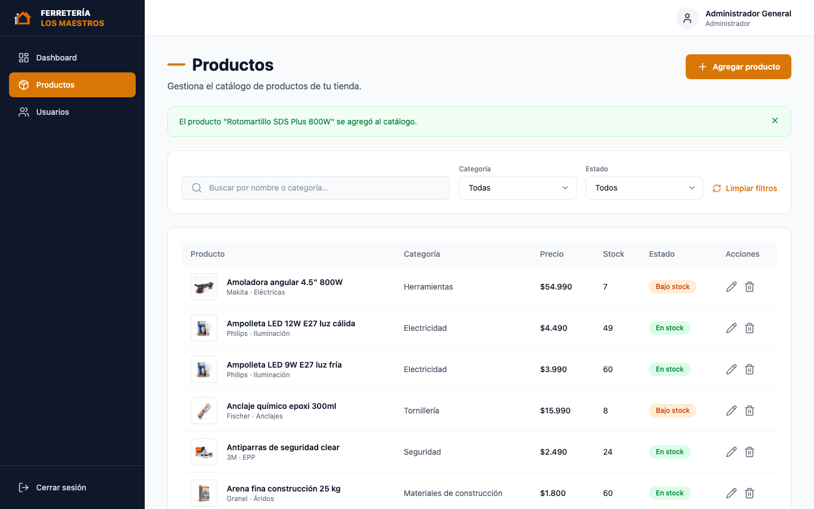

### 6.4 Editar un producto

Para encontrar el producto se puede escribir su nombre en el buscador. El botón **Editar** (ícono de lápiz) abre el mismo formulario con los datos actuales y el botón **Guardar cambios**. El **código** no se puede cambiar, porque identifica al producto. Los demás campos siguen las mismas reglas del punto 6.3.

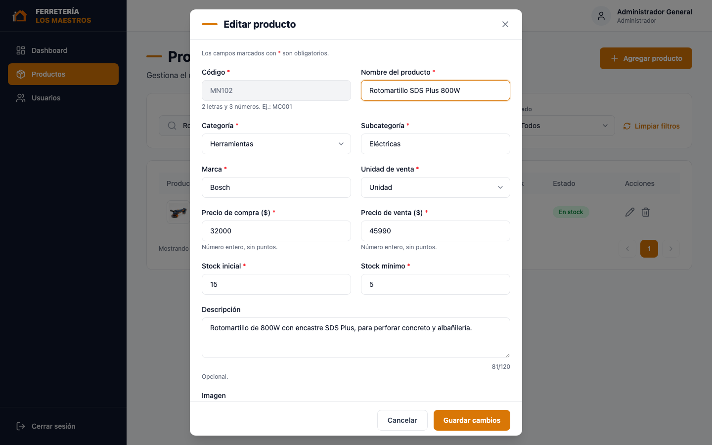

### 6.5 Eliminar un producto

El botón **Eliminar** (ícono de basurero) abre un cuadro del navegador que pide confirmar: *"¿Eliminar …? Dejará de mostrarse en la tienda."* Al pulsar **Aceptar** aparece el aviso *"El producto … se eliminó del catálogo."* y el producto ya no se encuentra en el panel ni en la tienda.

No se borra de la base de datos, para que los pedidos antiguos que lo incluyen sigan completos (es una *eliminación lógica*). Por lo mismo, su código queda ocupado y no se puede volver a usar.

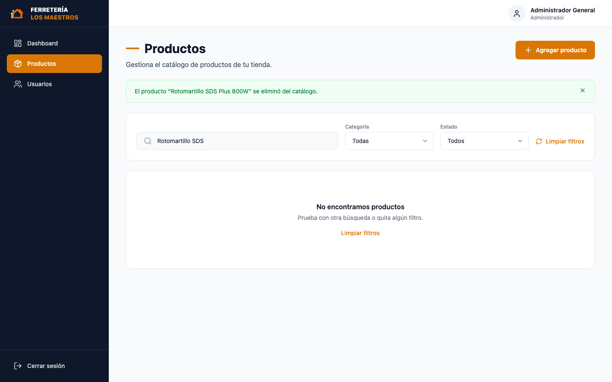

### 6.6 Lista de usuarios

La tabla muestra el nombre, el correo, el rol y el estado (*Activo* o *Inactivo*) de cada cuenta.

- **Buscador:** por nombre, correo o rol.
- **Filtros:** por rol y por estado.

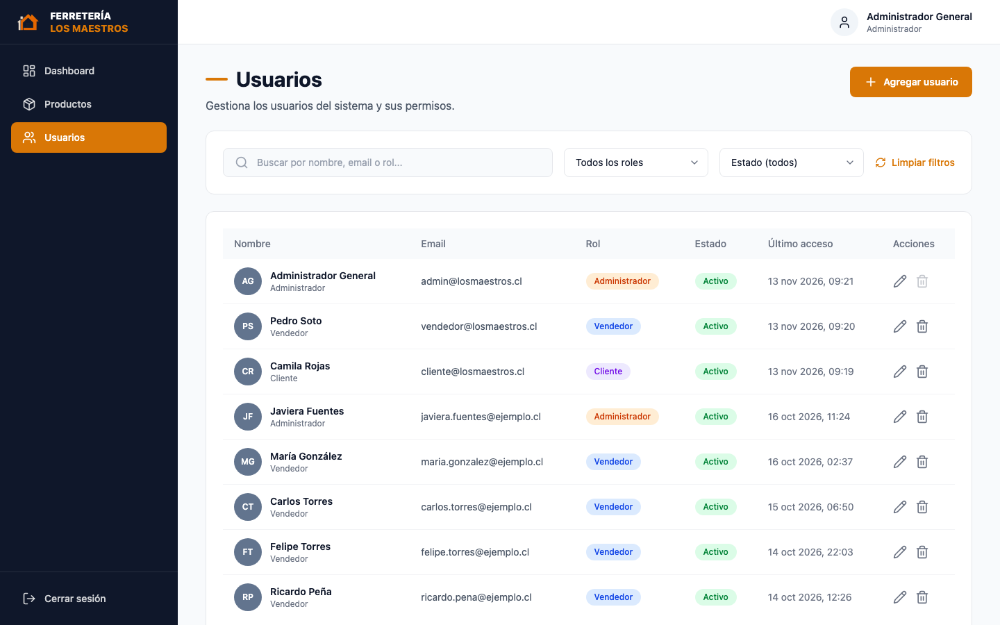

### 6.7 Agregar o editar un usuario

1. Pulsar **Agregar usuario**, o **Editar** en una fila.
2. Completar el formulario:

| Campo | Regla |
| --- | --- |
| Nombre completo | Nombre y apellido, solo letras, espacios, apóstrofes y guiones |
| Correo electrónico | Formato válido (ej. `nombre@dominio.cl`). No se puede repetir |
| Rol | Administrador, Vendedor o Cliente |
| Estado | Activo o Inactivo. Una cuenta inactiva no puede iniciar sesión |
| Contraseña / Confirmar contraseña | Entre 8 y 64 caracteres, sin espacios, con al menos una mayúscula, una minúscula y un número. Al editar se puede dejar en blanco para mantener la actual |

3. Pulsar **Agregar usuario** (al editar, **Guardar cambios**).

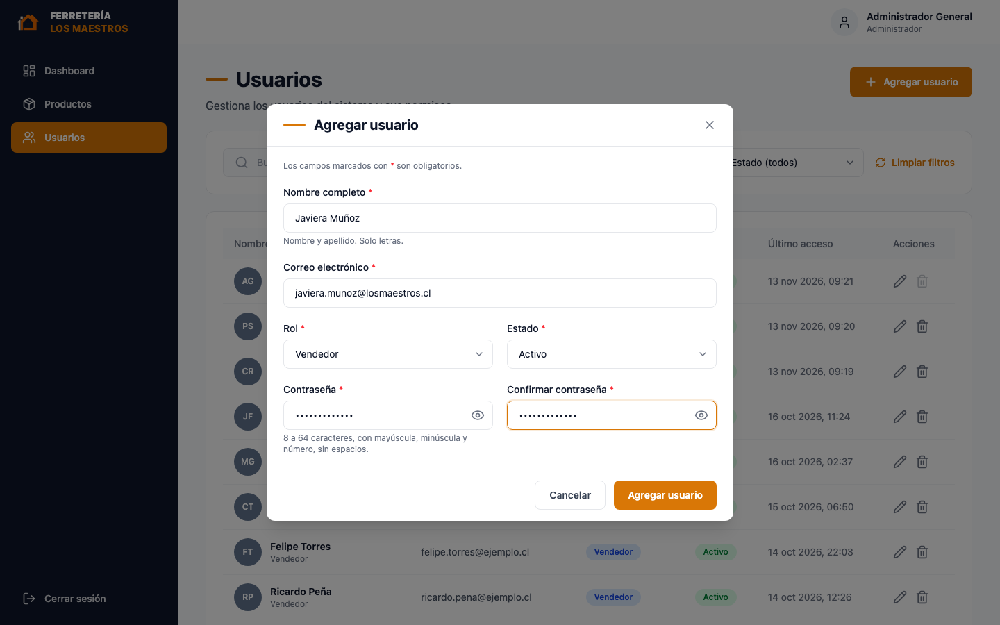

### 6.8 Eliminar un usuario

El botón **Eliminar** pide confirmación, porque la acción no se puede deshacer. Hay dos casos en que la aplicación no lo permite:

- **La propia cuenta:** en la fila de la cuenta con la que se inició sesión, el botón **Eliminar** aparece desactivado.
- **Un usuario con pedidos:** aparece el aviso *"El usuario tiene pedidos. Desactívalo en vez de eliminarlo"*. En ese caso se **edita** y se cambia su estado a **Inactivo**, así su historial de compras se conserva.

---

## 7. Sesión: recarga, expiración y cierre

- **Recargar la página (F5):** la sesión se mantiene. La aplicación guarda el token y, al recargar, le pide al backend los datos del usuario.
- **Expiración:** la sesión dura 60 minutos. Al vencer, la aplicación cierra la sesión y lleva al login con el aviso *"Tu sesión expiró. Inicia sesión nuevamente"*.
- **Cerrar sesión:** botón **Cerrar sesión** en la barra superior o en el panel. Borra la sesión del navegador y vuelve al inicio.

---

## 8. Mensajes frecuentes y cómo resolverlos

| Mensaje o síntoma | Causa | Qué hacer |
| --- | --- | --- |
| "No se pudo conectar con el servidor. Intenta nuevamente en unos minutos." | El backend no está corriendo o se detuvo | Revisar la terminal del backend y volver a ejecutar `./mvnw spring-boot:run` |
| El catálogo carga vacío o con error | La base de datos está apagada | Ejecutar `docker compose up -d` en `backend` y reiniciar el backend |
| "Correo o contraseña incorrectos" | Correo o contraseña mal escritos | Revisar los datos (ver las cuentas del punto 2.3) |
| "Tu cuenta está inactiva. Contacta al administrador" | Un administrador dejó la cuenta *Inactiva* | Un administrador debe editarla y dejarla *Activa* |
| "Tu sesión expiró. Inicia sesión nuevamente" | Pasaron más de 60 minutos desde el login | Volver a iniciar sesión |
| Al comprar, aviso de stock insuficiente | Otro pedido usó ese stock antes | Bajar la cantidad o quitar el producto del carrito |
| Al guardar un producto, error en "Código" | El código ya existe | Usar otro código |
| "El usuario tiene pedidos. Desactívalo en vez de eliminarlo" | El usuario ya hizo compras | Editarlo y dejarlo *Inactivo* |
| El backend no arranca: falta `JWT_SECRET` | No existe el archivo `backend/.env` | Copiar `.env.example` a `.env` y definir la clave |
